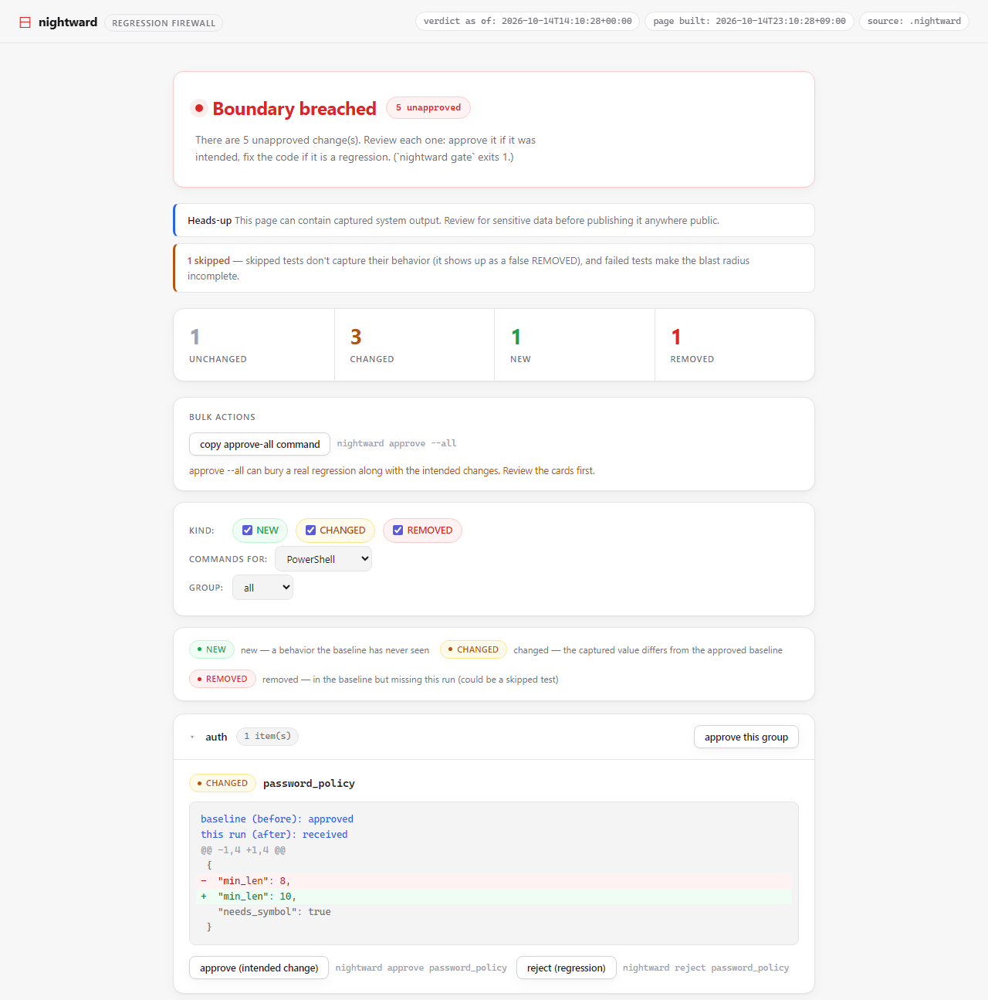

# Dashboard (`nightward view`)

[nightward](../README.md) reference. The static, read-only blast-radius dashboard.

`nightward view` renders the blast radius as a self-contained static site — boundary
status, counts, and grouped diffs with copy-paste `approve`/`reject` commands. It is
**read-only** (decisions stay in the CLI) and **static** (no backend), so it also
deploys to GitHub Pages. Data is loaded via `fetch('./data.json')` and rendered with
`textContent` only — captured output never touches an HTML parser. The page is a
snapshot of the store when it was built: after a new `run` or `approve`, rebuild it
with `nightward view` (refreshing the browser shows the old build). The header shows
the verdict's own time ("verdict as of", UTC) next to the build time. Only "intact" reads as done: "partial" (approved behaviors not checked), stale, incomplete and any boundary value the page does not know are shown as not done. A judge ruling read back from the committed ledger carries a "replayed" badge (not ruled this run).

The copy-paste commands quote every behavior name for the shell picked in
"commands for:" (bash/zsh/sh, PowerShell, or cmd.exe; PowerShell is the default on
Windows). A name such as `x;touch${IFS}pwned` therefore arrives as one literal
argument and never runs as code. When a name has no safe form in the selected shell
(`%` or `!` in cmd.exe), the dashboard says so and offers no command. A group's
"approve this group" command is `nightward approve --group G`, short at any group size.

> ⚠️ The dashboard embeds your captured behaviors. **Do not publish a real `.nightward/`
> store to a public site.** The Pages workflow only publishes synthetic clean-room data
> (`scripts/build_demo.py`). The default output dir `nightward-site/` is in the rules
> `nightward init` writes, and `view` warns when its output is not git-ignored.
